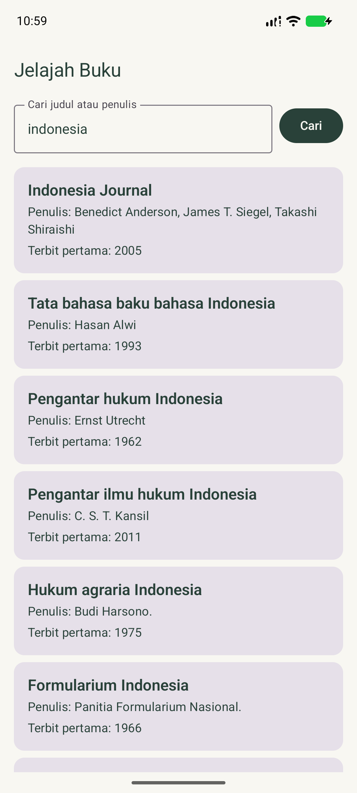
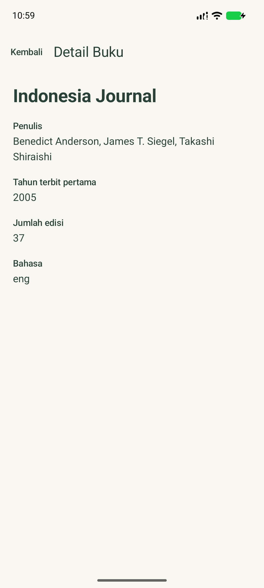

# Jelajah Buku — katalog OpenLibrary

Aplikasi Android Kotlin untuk mencari buku OpenLibrary. Dua layar saja: **Beranda** dan **Detail Buku**. Pencarian awal memakai kata `indonesia`; pengguna bisa menggantinya dan menekan **Cari** atau tombol cari di keyboard.

## Tampilan

| Beranda | Detail Buku |
| --- | --- |
|  |  |

## Fitur

- Pencarian dinamis dengan parameter `q` dan maksimum 20 buku; daftar menggunakan `LazyColumn` tanpa gambar.
- Judul, penulis, dan tahun terbit pertama di daftar; jumlah edisi dan bahasa ditambahkan di detail.
- Indikator loading, pesan gagal dengan tombol **Coba lagi**, pesan hasil kosong, dan pengganti teks untuk data yang tidak tersedia.
- Detail menerima objek buku terpilih melalui `savedStateHandle` milik entri navigasi Beranda; **tidak ada request detail**. Tombol **Kembali** membuka daftar sebelumnya.
- Material 3 dengan palet terang/gelap dan tipografi yang disesuaikan.

## Arsitektur MVVM

```text
BookHomeScreen / BookDetailScreen (View, Compose)
       ↕ StateFlow<UiState> / aksi pencarian
BookViewModel (Loading, Success, Error)
       ↓
BookRepository
       ↓
OpenLibraryApi (Retrofit + Gson) → OpenLibrary REST API
```

- `app/src/main/java/com/example/tugasprojekuts/data/Book.kt`: model respons dan data buku, field opsional nullable.
- `data/OpenLibraryApi.kt`: endpoint dan parameter query.
- `data/BookRepository.kt`: inisialisasi Retrofit dan pengambilan daftar buku.
- `BookViewModel.kt`: `StateFlow` UI, pencarian pertama, pembatalan pencarian sebelumnya, dan penanganan error.
- `MainActivity.kt`: `NavHost` dengan rute `home` dan `detail`; data buku pilihan disimpan di entri Beranda untuk dibaca layar Detail.
- `ui/BookScreens.kt`: UI kedua layar dan komponen kartu/field yang dipakai ulang.
- `ui/theme/`: `Color.kt`, `Theme.kt`, `Type.kt` (Light/Dark ColorScheme dan override tipografi).

## API dan teknis

OpenLibrary tanpa API key: `GET https://openlibrary.org/search.json?q={keyword}&limit=20`. Respons `docs[]` memuat `title`, `author_name`, `first_publish_year`, `edition_count`, `language`, dan `key`. Izin `INTERNET` ada di manifest. Stack: Kotlin, Jetpack Compose, Material 3, Retrofit, converter-gson, navigation-compose, lifecycle-viewmodel-compose. Tidak memakai library gambar; `cover_i` diabaikan.

## Jalankan / APK

Buka proyek di Android Studio dengan Android SDK 37 dan JDK yang kompatibel, lalu jalankan konfigurasi `app` pada emulator/perangkat dengan internet. Alternatif: `./gradlew :app:assembleDebug`. [Unduh APK debug](app-debug.apk) dari root repository; hasil build lokal berada di `app/build/outputs/apk/debug/app-debug.apk` (APK root disalin dari hasil build tersebut).

## Video penjelasan kode

[Tonton video penjelasan kode Jelajah Buku](https://youtu.be/RmngJs-HrD8).
